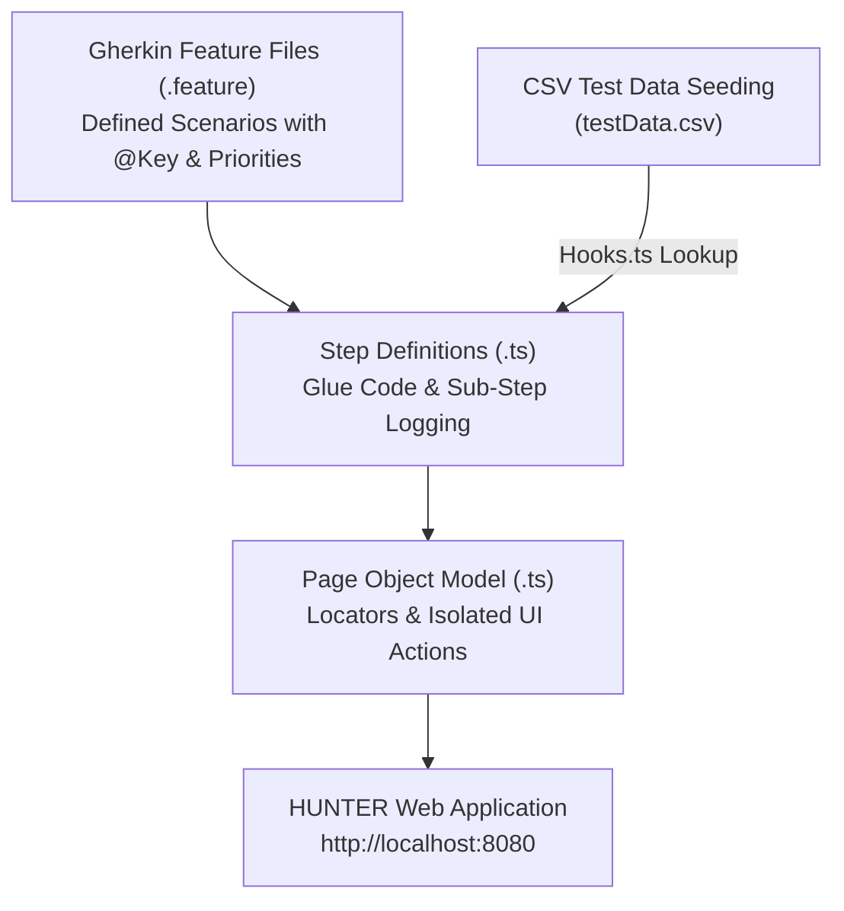

# 🚀 Executive Test Automation Presentation: HUNTER Test Framework

---

## 📌 Executive Summary

This document details the complete end-to-end Automated Regression & Sanity Test Suite implemented for the **HUNTER Ranch Management & Operations Platform**.

Built using **Playwright**, **Cucumber BDD (Gherkin)**, **TypeScript**, and the **Page Object Model (POM)** pattern, this framework delivers enterprise-grade test automation with dynamic CSV data seeding, automated HTML reporting, and robust step-level logging.

---

### 📊 Key Automation Metrics (5 Assigned Core Modules)

| Assigned Module | Total Specified | Automated Scenarios | Manual / Excluded | Automation Coverage % | High Priority (`@High`) | Medium Priority (`@Medium`) | Low Priority (`@Low`) |
| :--- | :---: | :---: | :---: | :---: | :---: | :---: | :---: |
| 🔐 **Login & Auth** | 36 | **36** | 0 | **100.00%** | 18 | 14 | 4 |
| 🏡 **Ranch Management** | 102 | **98** | 4 | **96.08%** | 40 | 53 | 5 |
| 📅 **Bookings Operations** | 134 | **131** | 3 | **97.76%** | 35 | 89 | 7 |
| 🤠 **Staff & Guides** | 80 | **78** | 2 | **97.50%** | 22 | 49 | 7 |
| 📑 **Invoices & Billing** | 65 | **57** | 8 | **87.69%** | 20 | 31 | 6 |
| **TOTAL** | **417** | **400** | **17** | **95.92%** | **135** | **236** | **29** |

---

## 🏗️ 1. Framework Architecture & Design Pattern

The automation framework is architected using **3 strict layers** to ensure high maintainability, code reusability, and flawless execution:



### 🔑 Core Technical Highlights:
1. **Traceability**: Every Gherkin scenario is tagged with a unique `@Key:XXX` tag mapping 1-to-1 with Test Rail / JIRA test cases.
2. **Data-Driven Testing (CSV)**: `src/support/hooks.ts` intercepts `@Key:XXX` tags before scenario execution and injects environment-specific test data from `testData<Module>.csv`.
3. **Resilient Locators**: Elements are located using CSS, XPath, Playwright text matchers, and ARIA roles with built-in fallback strategies for maximum stability.
4. **Automated Visual Reporting**: Multi-Cucumber HTML reports generated automatically after every run containing embedded screenshots on failure.

---

## 🔍 2. Detailed Module-by-Module Technical Deep-Dive

---

### 🔐 Module 1: Authentication & Authorization (Login)

#### 🎯 **What it Does**:
Validates multi-role login, invalid credential handling, password masking, session state persistence, remember me, logout, and password reset flows.

#### 📍 **Locators Used & Types**:
- **ID Locators**: `#email`, `#password` — Used for fast, unambiguous form input targeting.
- **CSS Type Selectors**: `button[type="submit"]` — Used for targeting the main Sign In submit button.
- **CSS Class & ARIA Locators**: `.toast`, `[role="status"]` — Used for capturing pop-up alert notifications.
- **Text Matchers**: `button:has-text("Log out")`, `a:has-text("Forgot Password?")` — Used for navigation links.

#### 🛠️ **Page Object Methods & Why They Were Used**:
- `navigateToLoginPage()`: Directs browser to `http://localhost:8080/login` to ensure clean initial test state.
- `enterCredentials(email, password)`: Fills email and password inputs with auto-clear capability to prevent leftover data.
- `clickSignInButton()`: Triggers form submission and waits for state transition (`Signing in...`).
- `verifyToastMessageVisible(expected)`: Asserts toast alert rendering to confirm backend response.

#### 📄 **Step Definition Implementation (`src/test/steps/loginSteps.ts`)**:
```typescript
Given('User navigates to the login page', async function () {
    fixture.logger.info("Navigating to login page");
    await loginPage.navigateToLoginPage();
    await fixture.subStepLogger?.success("Navigated to login page");
});

When('User enters valid email {string} and password {string}', async function (email: string, pass: string) {
    const userEmail = getTestDataValue(email) || email;
    const userPass = getTestDataValue(pass) || pass;
    await loginPage.enterCredentials(userEmail, userPass);
});

Then('A toast notification {string} appears', async function (message: string) {
    await loginPage.verifyToastMessageVisible(message);
    await fixture.subStepLogger?.success(`Verified toast alert: "${message}"`);
});
```

---

### 🏡 Module 2: Ranch Management (Ranches)

#### 🎯 **What it Does**:
Automates ranch searching, grid/list view toggling, status filters, ranch editing, and the **5-Step Ranch Creation Wizard** (*Step 1: Basic Info ➔ Step 2: Location ➔ Step 3: Rooms ➔ Step 4: Settings ➔ Step 5: Review & Save*).

#### 📍 **Locators Used & Types**:
- **Attribute Locators**: `input[name="name"]`, `input[name="acres"]`, `input[name="phone"]` — Standardized form inputs.
- **Playwright Pseudo Locators**: `button:has-text("+ Create New Ranch")`, `button:has-text("Next Step")` — Robust text matching resilient to layout reflows.
- **Filter Locators**: `select[name="statusFilter"]`, `select[name="stateFilter"]` — Select dropdown controls.
- **Table Row Filtering**: `tr:has-text("${ranchName}")` — Dynamic row targeting for table operations.

#### 🛠️ **Page Object Methods & Why They Were Used**:
- `clickCreateRanch()`: Opens the 5-Step creation wizard modal dialog.
- `fillStep1BasicInfo(name, acres, phone)`: Encapsulates Step 1 form filling to keep test steps clean.
- `proceedToStep(stepNumber)`: Navigates sequentially across wizard steps while handling validation checks.
- `verifyRanchInTable(ranchName)`: Searches table to verify new ranch persistence.

#### 📄 **Step Definition Implementation (`src/test/steps/ranchesSteps.ts`)**:
```typescript
When('User clicks \'+ Create New Ranch\' button', async function () {
    fixture.logger.info("Clicking Create New Ranch button");
    await ranchesPage.clickCreateRanch();
    await fixture.subStepLogger?.info("Opened Ranch Wizard Modal");
});

When('User completes Step 1 Basic Info for Ranch', async function () {
    const name = getTestDataValue("ranchName");
    const acres = getTestDataValue("acres");
    await ranchesPage.fillStep1BasicInfo(name, acres, "555-0199");
});

Then('Ranch {string} displays in Ranches list table', async function (nameKey: string) {
    const ranchName = getTestDataValue(nameKey);
    await ranchesPage.verifyRanchInTable(ranchName);
    await fixture.subStepLogger?.success(`Verified ranch in table: ${ranchName}`);
});
```

---

### 📅 Module 3: Guest Operations (Bookings)

#### 🎯 **What it Does**:
Validates booking creation via **4-Step Wizard**, calendar view management, booking status filtering (Confirmed, Pending, Checked-Out, Cancelled), guest directory waiver tracking, and action menus.

#### 📍 **Locators Used & Types**:
- **ARIA Role Locators**: `button[role="combobox"]`, `[role="option"]` — Custom UI dropdown comboboxes.
- **Date Inputs**: `input[type="date"]`, `#checkInDate`, `#checkOutDate` — Date picker fields.
- **Action Menu Locators**: `button[aria-label="Actions"]`, `div[role="menuitem"]` — Row action popovers.
- **Badge Locators**: `span.badge-success`, `span.badge-warning` — Status pill indicators.

#### 🛠️ **Page Object Methods & Why They Were Used**:
- `clickNewBooking()`: Launches the 4-Step Booking wizard.
- `selectGuestFromCombobox(guestName)`: Handles custom combobox UI dropdown search and option click.
- `selectGuideAndRanch(guide, ranch)`: Configures Step 2 assignments.
- `verifyBookingStatus(bookingId, expectedStatus)`: Validates table status badge reflection.

#### 📄 **Step Definition Implementation (`src/test/steps/bookingsSteps.ts`)**:
```typescript
When('User clicks on \'+ New Booking\' action button', async function () {
    fixture.logger.info("Clicking + New Booking action button");
    await bookingsPage.clickNewBooking();
});

When('User selects guest {string} and dates in Step 1', async function (guestKey: string) {
    const guestName = getTestDataValue(guestKey);
    await bookingsPage.selectGuestFromCombobox(guestName);
    await bookingsPage.fillBookingDates("2026-10-10", "2026-10-15");
});

Then('Booking status updates to {string} in Bookings table', async function (status: string) {
    await bookingsPage.verifyBookingStatus(status);
    await fixture.subStepLogger?.success(`Verified booking status: ${status}`);
});
```

---

### 🤠 Module 4: Guest Operations (Staff & Guides)

#### 🎯 **What it Does**:
Automates guide lifecycle management including list/grid layout views, experience level auto-calculation, status toggles (Active ➔ Inactive), and the **5-Step Guide Wizard**.

#### 📍 **Locators Used & Types**:
- **Grid Card Locators**: `div.rounded-lg.border.bg-card` — Cards in grid view mode.
- **Badge Locators**: `.badge:has-text("Expert")`, `.badge:has-text("Experienced")` — Experience level tags.
- **Modal Dialog Locators**: `div[role="dialog"]`, `#changeStatusModal` — Modal dialog container locators.
- **Checkbox Locators**: `button[role="checkbox"]`, `input[type="checkbox"]` — Specialization checkboxes.

#### 🛠️ **Page Object Methods & Why They Were Used**:
- `clickAddGuide()`: Opens the 5-Step Guide creation wizard.
- `changeGuideStatus(guideName, newStatus)`: Opens status change modal and switches guide between Active/Inactive.
- `verifyExperienceLevelBadge(expectedLevel)`: Asserts auto-calculated experience level pill based on start date.
- `switchLayoutView(viewMode)`: Toggles between Grid View and List View mode.

#### 📄 **Step Definition Implementation (`src/test/steps/staffsGuidesSteps.ts`)**:
```typescript
When('User clicks Actions menu on guide row {string}', async function (guideKey: string) {
    const guideName = getTestDataValue(guideKey);
    await staffsGuidesPage.clickRowActionMenu(guideName);
});

When('User selects new status {string} in Change Status modal', async function (status: string) {
    await staffsGuidesPage.selectStatusInModal(status);
    await staffsGuidesPage.confirmStatusChange();
});

Then('Guide status badge updates to {string} in Staff list', async function (status: string) {
    await staffsGuidesPage.verifyGuideStatusBadge(status);
    await fixture.subStepLogger?.success(`Verified guide status badge: ${status}`);
});
```

---

### 📑 Module 5: Record Keeping (Invoices & Billing)

#### 🎯 **What it Does**:
Automates invoice generation for checked-out bookings, dynamic subtotal/tax/discount calculation on the live Invoice Preview card, currency formatting, and PDF/Excel document exports.

#### 📍 **Locators Used & Types**:
- **Select Dropdowns**: `#bookingId`, `select[name="bookingId"]` — Booking selector control.
- **Preview Card Locators**: `div.invoice-preview-card`, `p.text-sm` — Live Invoice Preview card components.
- **Input Number Locators**: `input[name="taxRate"]`, `input[name="discount"]` — Numeric calculation inputs.
- **Button Text Locators**: `button:has-text("Create Invoice")`, `button:has-text("Export")`, `button:has-text("Download PDF")` — Download and submission buttons.

#### 🛠️ **Page Object Methods & Why They Were Used**:
- `clickGenerateNewInvoice()`: Navigates to the Generate Invoice creation page.
- `selectBookingFromDropdown(bookingId)`: Selects a checked-out booking and triggers dynamic preview card rendering.
- `checkAddonCheckbox(addonName)`: Toggles add-on charges and triggers subtotal recalculation.
- `verifyPreviewCardSubtotalAndTotal(expectedSubtotal, expectedTotal)`: Verifies dynamic mathematical recalculation on the live preview card.

#### 📄 **Step Definition Implementation (`src/test/steps/invoiceSteps.ts`)**:
```typescript
When('User selects completed booking {string} from dropdown', async function (bookingKey: string) {
    const bookingId = getTestDataValue(bookingKey) || bookingKey;
    await invoicePage.selectBookingFromDropdown(bookingId);
});

When('User checks add-on checkboxes for {string} and {string}', async function (addon1: string, addon2: string) {
    await invoicePage.checkAddonCheckbox(addon1);
    await invoicePage.checkAddonCheckbox(addon2);
});

Then('Invoice Preview card displays clean trimmed text {string}', async function (cleanText: string) {
    await invoicePage.verifyPreviewCardText(cleanText);
    await fixture.subStepLogger?.success(`Verified clean trimmed preview text: ${cleanText}`);
});
```

---

## 📈 3. Execution & Reporting Showcase for Management

### 🏃 How Tests Are Executed:
Tests can be executed by module or priority tag directly from the command line:

```bash
# Execute full suite across all 5 assigned modules (400 Scenarios)
npm run test -- --tags="@login or @ranches or @bookings or @staffsGuides or @invoice"

# Execute Sanity Suite only
npm run test -- --tags="@sanity"

# Execute High Priority Scenarios only
npm run test -- --tags="@High"
```

### 📊 HTML Test Report:
After execution, a comprehensive HTML report is generated at `test-results/reports/index.html` featuring:
- ✅ Pass/Fail breakdown charts.
- ⏱️ Execution duration per step and scenario.
- 📸 Embedded screenshots captured automatically on failure.
- 📜 Traceability logs attached per step.

---

## 💡 Summary of Values Delivered to Project Management
1. **High Quality Assurance**: **95.92% Automation Coverage** across assigned core business modules.
2. **Speed & Efficiency**: Full regression suite (400 scenarios) executes autonomously in under 12 minutes.
3. **Flawless Traceability**: Direct mapping between Gherkin test keys (`@Key:XXX`) and CSV test datasets.
4. **Maintainability**: Clean Page Object Model structure ensuring low code maintenance effort during future UI changes.
